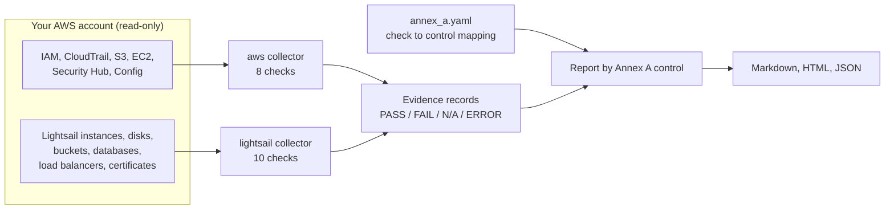

# iso27001-evidence-collector

[](https://github.com/larcz94/ISO27001-evidence-collector/actions/workflows/tests.yml)


Automated, read-only evidence collection for **ISO/IEC 27001:2022 Annex A**
controls on AWS and Amazon Lightsail.

Instead of taking screenshots before every audit, the tool reads security
settings through the AWS APIs, maps each result to Annex A control IDs, and
writes an audit-ready report in Markdown, HTML and JSON.

```console
$ iso27001-evidence collect --source lightsail --region eu-central-1
FAIL  lightsail.bucket.access_logging            1 of 2 buckets have access logging enabled
FAIL  lightsail.bucket.public_access             1 of 2 buckets are private with no public object overrides
PASS  lightsail.certificate.expiry               0 of 1 certificates expire within 30 days
PASS  lightsail.database.backup_and_exposure     1 of 1 databases have backups on and are not publicly accessible
PASS  lightsail.disk.auto_snapshots              1 of 1 block storage disks have automatic snapshots enabled
FAIL  lightsail.instance.admin_ports_restricted  1 admin port(s) open to the internet across 2 instance(s)
FAIL  lightsail.instance.auto_snapshots          1 of 2 instances have automatic snapshots enabled
FAIL  lightsail.instance.blueprint_supported     1 of 2 instances run a blueprint (OS image) that Lightsail has retired
FAIL  lightsail.instance.imdsv2_required         1 of 2 instances require IMDSv2
PASS  lightsail.loadbalancer.https_only          1 of 1 load balancers serve HTTPS and redirect HTTP to HTTPS

Markdown: reports/evidence-20261114T172900Z.md
HTML:     reports/evidence-20261114T172900Z.html
JSON:     reports/evidence-20261114T172900Z.json
```

The output above comes from fake data. Full sample reports:
[AWS](examples/sample-report.md), [Lightsail](examples/sample-report-lightsail.md)
and a combined [HTML report](examples/sample-report-all.html) (download and open it in a browser).

## Findings and fixes

A FAIL is only useful if you know what failed and what to do about it. For
every failed check the report names the affected resources, the Annex A
controls and a fix suggestion:

```markdown
### 1. lightsail.instance.admin_ports_restricted

- **Finding:** 1 admin port(s) open to the internet across 2 instance(s)
- **Controls:** A.8.20
- **Affected (exposed admin ports):**
  - instance: worker-1; port: 22; service: SSH; open to: 0.0.0.0/0
- **How to fix:** In the Lightsail console open the instance, go to the
  Networking tab and edit the SSH (22) or RDP (3389) rule in the IPv4 firewall:
  restrict it to your own IP addresses, or allow only Lightsail browser SSH/RDP.
  Do the same in the IPv6 firewall, or turn IPv6 off if you do not use it.
```

Fix suggestions are general guidance. Review them against your own policies
before you change a production system. The same data is in the JSON file
(`details` and `remediation` fields) if you want to create tickets from it.

## How it works



1. **Collectors** run read-only checks, one module per source
   ([`collectors/`](src/iso27001_evidence/collectors)). A failing API call becomes an
   ERROR result and never stops the run.
2. **Control mapping** in [`annex_a.yaml`](src/iso27001_evidence/mappings/annex_a.yaml)
   links each check to one or more Annex A controls.
3. **Reports** group the results by control, with a timestamp and the account
   they came from. Every failed check is listed under "Findings to fix" with
   the affected resources and a fix suggestion.
4. **Scheduling** with a [GitHub Actions workflow](.github/workflows/collect-evidence.yml)
   and OIDC, so no AWS keys are stored.

> Automated evidence **supports** a control. It does not prove it on its own.
> Policies, procedures and records are still needed. The report lists what
> else to provide for each control.

## Quick start

```bash
git clone https://github.com/larcz94/ISO27001-evidence-collector.git
cd ISO27001-evidence-collector
pip install -e .

# uses your normal AWS credentials (profile, SSO, env vars)
iso27001-evidence list-checks --source all
iso27001-evidence collect --source lightsail --region eu-central-1
iso27001-evidence collect --source aws --region eu-central-1
iso27001-evidence collect --source all --region eu-central-1   # one combined report
```

Reports are written to `reports/`, which is git-ignored because real reports
contain account details. Add `--fail-on-gap` to get exit code 1 when a check
fails, which is useful in CI.

### Permissions

The tool never changes anything. Give the user or role that runs it only the
policy for the sources you use:

| Source | Policy |
|---|---|
| `aws` | [`policies/aws-readonly-policy.json`](policies/aws-readonly-policy.json) |
| `lightsail` | [`policies/lightsail-readonly-policy.json`](policies/lightsail-readonly-policy.json) |

## Checks

### Amazon Lightsail (10 checks)

Small setups often run on Lightsail instead of EC2, and they are still in
scope for an ISMS. Lightsail is regional, so run the collector once per
region you use.

| Check ID | What it verifies | Annex A |
|---|---|---|
| `lightsail.instance.auto_snapshots` | Every instance has automatic snapshots on | A.8.13 |
| `lightsail.disk.auto_snapshots` | Every block storage disk has automatic snapshots on | A.8.13 |
| `lightsail.instance.admin_ports_restricted` | SSH (22) and RDP (3389) are not open to `0.0.0.0/0` or `::/0` | A.8.20 |
| `lightsail.instance.imdsv2_required` | Instances require IMDSv2 for the metadata service | A.8.9 |
| `lightsail.instance.blueprint_supported` | The OS image (blueprint) is still offered by Lightsail, not retired | A.8.8 |
| `lightsail.bucket.public_access` | Buckets are private and do not allow public object overrides | A.8.3 |
| `lightsail.bucket.access_logging` | Buckets have access logging on | A.8.15 |
| `lightsail.database.backup_and_exposure` | Managed databases keep backups and are not publicly accessible | A.8.3, A.8.13, A.8.20 |
| `lightsail.loadbalancer.https_only` | Load balancers serve HTTPS and redirect HTTP to HTTPS | A.8.24 |
| `lightsail.certificate.expiry` | No issued certificate expires within 30 days | A.8.24 |

### AWS (8 checks)

| Check ID | What it verifies | Annex A |
|---|---|---|
| `aws.iam.root_mfa` | Root account has MFA | A.5.17, A.8.2, A.8.5 |
| `aws.iam.console_users_mfa` | Every IAM user with console access has MFA | A.8.5 |
| `aws.iam.password_policy` | Minimum length 14 or more and password reuse prevention | A.5.17 |
| `aws.cloudtrail.multi_region_logging` | An active multi-region CloudTrail trail exists | A.8.15 |
| `aws.s3.bucket_protection` | Buckets are encrypted and block public access | A.8.3, A.8.24 |
| `aws.ec2.ebs_default_encryption` | EBS encryption by default is on | A.8.24 |
| `aws.securityhub.findings_summary` | Security Hub is enabled, counts open critical and high findings | A.8.8, A.8.16 |
| `aws.config.recorder_and_compliance` | AWS Config is recording, lists non-compliant rules | A.8.9 |

## Run it every week with GitHub Actions (no stored keys)

The [collect-evidence workflow](.github/workflows/collect-evidence.yml) runs
every Monday. It uses GitHub OIDC to get short-lived credentials, so there are
no access keys to store or rotate.

1. Deploy [`infra/github-oidc-role.yaml`](infra/github-oidc-role.yaml) once with
   CloudFormation. It creates the GitHub OIDC provider and a read-only role
   that only this repository and branch can assume:

   ```bash
   aws cloudformation deploy \
     --stack-name iso27001-evidence-role \
     --template-file infra/github-oidc-role.yaml \
     --capabilities CAPABILITY_IAM \
     --parameter-overrides GitHubOwner=<your-github-user> EnableLightsailChecks=true
   ```

   IAM is free, so this stack has no cost. If your account already has a GitHub
   OIDC provider, add `CreateOIDCProvider=false`.
2. In the repository settings, add these **variables** (not secrets):
   `AWS_EVIDENCE_ROLE_ARN` (the stack output `RoleArn`), `AWS_REGION`, and
   optionally `EVIDENCE_SOURCES` (for example `lightsail` or `aws lightsail`).
3. Run the workflow by hand once from the Actions tab to test it.

Reports are uploaded as private workflow artifacts and kept for 90 days. They
are never committed to the repository.

## Running tests

No AWS account is needed. AWS tests use [moto](https://github.com/getmoto/moto).
moto does not cover Lightsail, so those tests use botocore's `Stubber` with
fixed API responses.

```bash
pip install -e ".[dev]"
ruff check src tests
pytest -q
```

## Roadmap

- [x] Collector framework and Annex A mapping
- [x] AWS collector (8 checks)
- [x] Amazon Lightsail collector (10 checks)
- [x] Markdown, HTML and JSON reports
- [x] Findings with affected resources and fix suggestions
- [x] GitHub Actions scheduled run with OIDC and a CloudFormation role template
- [ ] Checks across all regions in one run
- [ ] Publish to PyPI
- [ ] GitLab / GitHub collector (branch protection, reviews)
- [ ] Microsoft 365 / Entra ID collector
- [ ] Linux server collector

## Why

As an ISMS lead and DevOps engineer, I found that most audit effort goes into
collecting evidence, not fixing gaps. This project automates the collection part.

## Security

Please do not open a public issue for a security problem. Use **Report a vulnerability**
under the Security tab of this repository.

## Contributing

New collectors and checks are welcome. Collectors must stay read-only, every new
API call goes into the matching file in `policies/` and into
`infra/github-oidc-role.yaml`, and every check needs a test.
Open an issue first for larger changes.

## License

MIT
